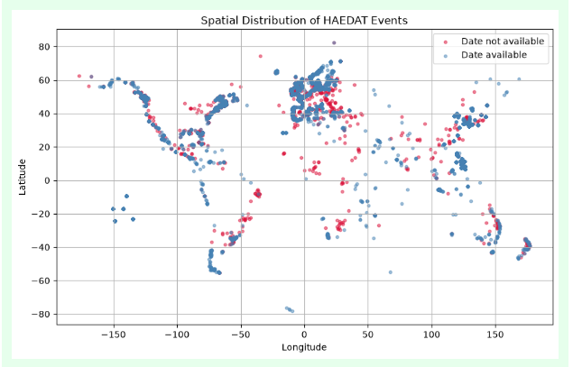
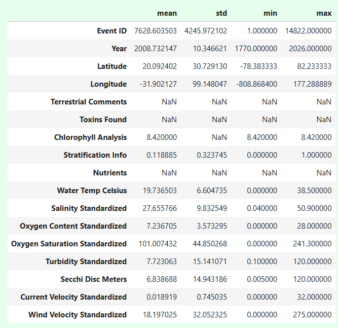
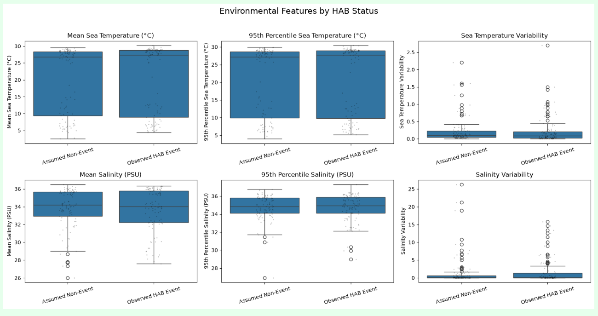
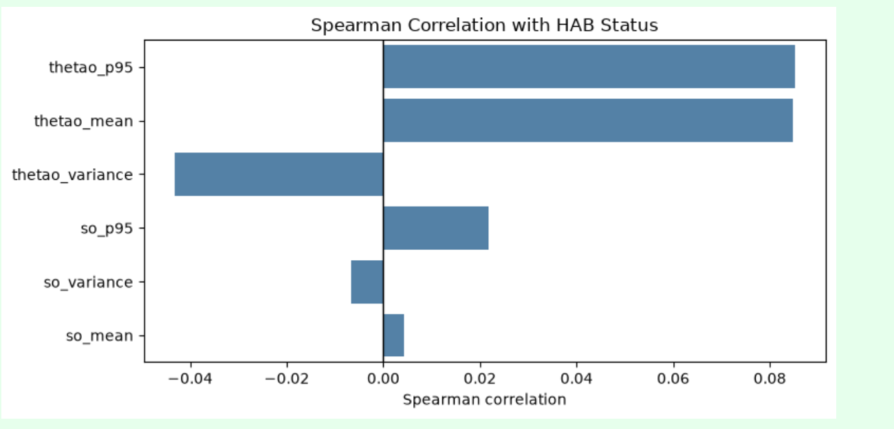

# Milestone #1 
## Address missing values and outliers
Missing columns of note
- Event Date
- Start Date
- End Date
- Latitude
- Longtitude

For missing event date, start date, AND end date -> Dropped them (However, all rows have a year)\
For missing latitude and longtitude -> Dropped them 
For the outlier longtitude (was ~-800, shifted the decimal forward)

Since there are still missing event date, start date, XOR end date. Decided to add a target date column. It follows these rules: 
Rule 1: If Start Date is empty, BUT both Event Date & End Date exist -> Pick Middle of Event and End\
Rule 2: If Start Date and End Date exist -> Pick Middle of Start and End\
Rule 3: If Start Date is empty -> Fallback to Event Date\
Rule 4: If Event Date is empty -> Fallback to Start Date

# Milestone #2
## Conducting HAB 
From looking at the correlation between variables and HAB events, it appears that the sea temperature is a possible correlation. It is done with spearman and pearson correlation, where spearman appeared to show a higher correlation.

